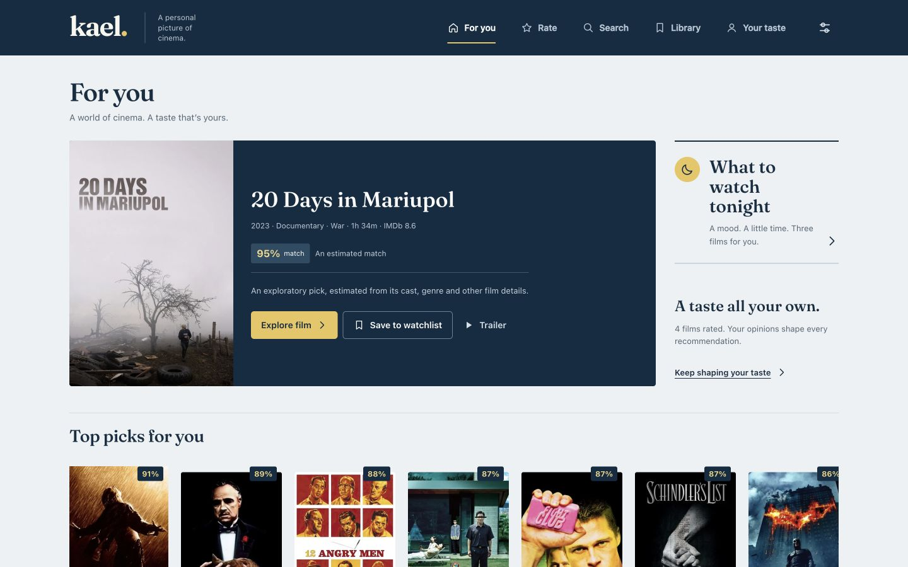
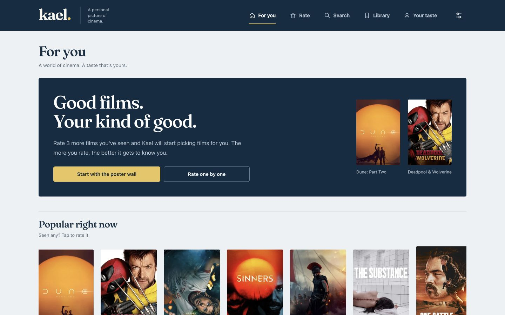

# Kael redesign — implementation and verification

## Product and direction

This is a substantial redesign of the existing working film companion. It keeps the Bayesian model, catalog, local data formats, sharing, imports and static deployment intact. The identity comes from film title sequences: actual art beside expressive titles, a navy frame, a cool reading ground, and gold reserved for the next important action. Recommendations carry real supporting films when available and explain estimates honestly when support is absent.

[PRODUCT.md](../PRODUCT.md) records audience, assumptions and outcomes. [DESIGN.md](../DESIGN.md) and [.impeccable/design.json](../.impeccable/design.json) record the implemented rules and reusable components. The [direction record](../.impeccable/direction.md) explains the reference study and its inspection limitations.

## Run the source preview

The source branch intentionally does not contain the published catalog. To preview without retraining or rebuilding it, clone the public site branch beside this checkout and link its data:

```sh
git clone --depth 1 --branch site https://github.com/gwilltsherman-byte/paulinekael.git ../kael-preview-data
ln -s ../../kael-preview-data/data web/data
python3 -m http.server 8767 --bind 127.0.0.1 --directory web
```

Open http://127.0.0.1:8767/. The data link is ignored by Git. Use a separate browser profile for disposable test ratings. The published production site is unchanged until this branch is merged and the normal publishing workflow completes.

## Verification performed

- 58 JavaScript tests passed, including four added regression checks for calendar dates and dialog focus containment.
- Six Python tests passed. Existing test code reports unclosed-file ResourceWarnings; no failures.
- Every web JavaScript module and script passed syntax checking; Python compilation passed using a writable temporary bytecode cache.
- Full catalog smoke test passed: 149,132 films, 145,119 posters and 47,219 films with streaming data; build 20261014033348. Quick/full index compatibility and a real engine quiz are included.
- Browser exercise: a fresh visit; three ratings unlocking personalized picks; Tonight with Mind-bending and Under 2h; saving The Usual Suspects; reload persistence; logging it on 2026-10-16; rejecting a future diary date; Watchlist removal after logging; Diary and Ratings navigation; arrow-key Library tabs; Escape and Tab containment in the rating dialog; punctuation-aware WALL-E search; empty-result recovery; poster-wall selection and queued rating; Netflix selection; Your taste and film details.
- Screenshot review at 1440×900 desktop, 390×844 phone and the 1280×720 normal preview viewport; the 320×720 home boundary also retained full poster proportions with no horizontal overflow. Representative screens: first visit, recommendations, rating, Tonight, film details, search, poster wall, settings, taste and diary. Browser console error log was empty after the exercised flows.
- One combined visual/a11y review and coordinated correction pass. Corrections cover poster proportions, first-viewport density, truthful recommendation explanations, action hierarchy, genre labels, artwork fallback, SVG arrows, heading hierarchy, small functional labels, and retry-button contrast. The confirmation verdict resolved all seven material design findings. A fresh generic reviewer substituted for the unavailable specialized Impeccable reviewer; a fresh documenter extracted the design rules.
- The Impeccable detector ran once. Its Fraunces warning is an intentional exception: this existing, licensed, locally hosted face is retained for continuity. Composition, real art and personalized explanations supply the app-specific identity. Other actionable findings were corrected; no claim of a zero-warning second scan.

## Screenshots

The screenshots show real catalog data and disposable local ratings entered only for verification. They are not seeded into the app or production storage.





[Phone recommendations](screenshots/redesign-mobile.jpg) · [Desktop rating](screenshots/redesign-desktop-rate.jpg) · [Phone rating](screenshots/redesign-mobile-rate.jpg) · [Film detail](screenshots/redesign-desktop-film.jpg) · [Search](screenshots/redesign-desktop-search.jpg)

## Limits of this verification

Native backup sharing did not yield a downloadable file in the in-app browser harness, so a browser backup/restore round trip was not verified. Existing import, ZIP, share-link and storage compatibility behavior is preserved and covered by applicable unit tests. Physical iOS/Safari installation, OS share sheets, assistive-technology announcements, forced offline/network-failure recovery, and OS reduced-motion emulation were not exercised. Reduced-motion rules and zoom support are implemented. No claim of exhaustive WCAG certification is made.

Posters and trailers still depend on TMDB images and YouTube. Streaming information remains US-only and reflects the exported catalog. There is no new account, server sync or live streaming integration.
